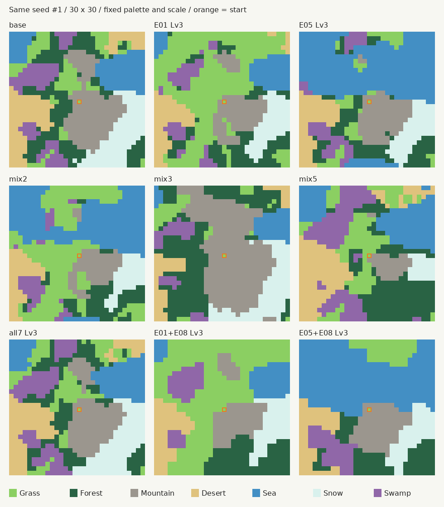
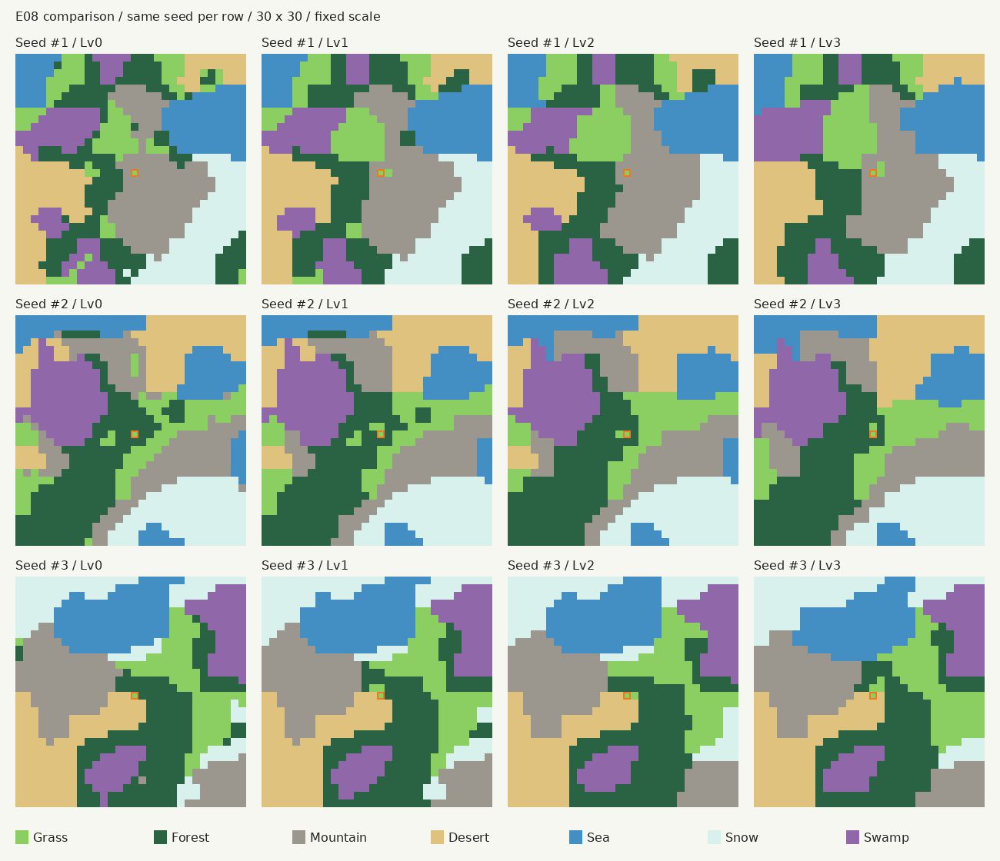

# 地形生成刷新 ver.48 検証レポート

> 2026-10-25整合：版を固定した過去の測定/移行記録。元の数値・表は変更しない。現在の仕様は../README.md、E系地形生成仕様.md。再現には当該版のコード/入力が必要で、現在の同名テストを走らせても当時の計測値を再現したことにはならない。末尾チェック欄があっても当時提示した確認票。受入根拠は../変更履歴.md。 現在の入口は../README.md、受入の詳細は../変更履歴.md。


2026-10-24。v24.19.0上で30×30、32条件それぞれ1000回、計32000マップを測定。実際の施設30個を含む。

## 変更の要点

- E01〜E07は追加重みx=d/(1-p-d)、P=(p+x)/(1+Σx)で単独+10/20/30ポイント。基本比率は11/20/18/14/13/13/11%。
- 大陸・標高・気温・湿度を各3層ノイズで生成。ノイズを一様乱数とみなす抽選はせず、目標整数面積を気候適性に沿って配置。
- 開始草原を目標面積の中で予約。E08の面積維持整形を施設前に適用し、旧E09生成補正は廃止。
- 49体のスキル・コストを移行し、旧保存のスナップショットはメモリ上でE09→E08へ正規化。生成済み地形・施設・所持数は変更しない。
- グレースケール化は今回含めていない。

## 単独加護：理論と実測（対象地形%）

各セルは「理論 / 実測」。全Lvで各1000マップ。

| 加護 | 基本比率 | Lv1 | Lv2 | Lv3 |
|---|---:|---:|---:|---:|
|E01 草原|11.00|21.00 / 21.00|31.00 / 31.00|41.00 / 41.00|
|E02 森林|20.00|30.00 / 30.00|40.00 / 40.00|50.00 / 50.00|
|E03 山岳|18.00|28.00 / 28.00|38.00 / 38.00|48.00 / 48.00|
|E04 砂漠|14.00|24.00 / 24.00|34.00 / 34.00|44.00 / 44.00|
|E05 海|13.00|23.00 / 23.00|33.00 / 33.00|43.00 / 43.00|
|E06 雪原|13.00|23.00 / 23.00|33.00 / 33.00|43.00 / 43.00|
|E07 毒の沼地|11.00|21.00 / 21.00|31.00 / 31.00|41.00 / 41.00|

全32条件で7地形すべての目標と実測の差が0.12ポイント未満。単独の対象地形は900マスへ整数で割り切れ、表の比率と一致する。他地形・複数併用では整数配分の丸め誤差が残る。施設配置の救済が発生する場合は、その後の変更として区別する。

## 加護なし・複数加護：全地形の理論と実測

各セルは「理論 / 実測」。mix2=E01/E05各Lv3、mix3=E02 Lv2/E03 Lv3/E06 Lv1、mix5=E01/E02/E04/E05/E07各Lv3、all7=全7種Lv3。

### base

| 地形 | 理論% | 実測% |
|---|---:|---:|
|草原|11.0000|11.0000|
|森林|20.0000|20.0000|
|山岳|18.0000|18.0000|
|砂漠|14.0000|14.0000|
|海|13.0000|13.0000|
|雪原|13.0000|13.0000|
|毒の沼地|11.0000|11.0000|

### mix2

| 地形 | 理論% | 実測% |
|---|---:|---:|
|草原|30.3950|30.4444|
|森林|9.8290|9.7778|
|山岳|8.8461|8.8889|
|砂漠|6.8803|6.8889|
|海|32.2547|32.2222|
|雪原|6.3889|6.3333|
|毒の沼地|5.4060|5.4444|

### mix3

| 地形 | 理論% | 実測% |
|---|---:|---:|
|草原|5.3918|5.4444|
|森林|26.1422|26.1111|
|山岳|37.1018|37.1111|
|砂漠|6.8623|6.8889|
|海|6.3722|6.3333|
|雪原|12.7379|12.7778|
|毒の沼地|5.3918|5.3333|

### mix5

| 地形 | 理論% | 実測% |
|---|---:|---:|
|草原|16.8110|16.7778|
|森林|21.7452|21.7778|
|山岳|4.8927|4.8889|
|砂漠|18.3669|18.3333|
|海|17.8396|17.8889|
|雪原|3.5336|3.5556|
|毒の沼地|16.8110|16.7778|

### all7 Lv3

| 地形 | 理論% | 実測% |
|---|---:|---:|
|草原|12.9328|12.8889|
|森林|16.7286|16.7778|
|山岳|15.8279|15.7778|
|砂漠|14.1297|14.1111|
|海|13.7241|13.7778|
|雪原|13.7241|13.7778|
|毒の沼地|12.9328|12.8889|

## 生成マップ比較



全パネルで同じシード・配色・10pxセルを使用。基礎気候は同じで加護に応じて面積が変わる。海は無加護13%、E05 Lv3だけ43%。固定図形テンプレートを使用していない。

## 多層ノイズ・E08の比較

各1000マップの平均。孤立は上下左右で連結した1〜2マスの成分。線状は幅1で6マス以上の水平/垂直区間。

| 指標 | E08なし | Lv1 | Lv2 | Lv3 |
|---|---:|---:|---:|---:|
|同種隣接率%|80.264|82.780|84.251|86.301|
|連結成分数|33.334|21.244|17.870|13.223|
|孤立1〜2マス成分|11.176|0.551|0.628|0.558|
|6マス未満成分|15.149|3.767|1.081|0.642|
|12マス未満成分|18.982|7.151|4.046|0.665|
|最大成分面積|142.689|146.268|149.363|155.568|
|長い幅1区間|0.313|0.309|0.245|0.077|
|海岸線の辺数|55.785|54.187|52.276|49.028|
|平均生成ms|1.675|3.654|6.121|9.689|
|p95生成ms|2.346|5.091|9.055|15.510|
|最大生成ms|9.948|14.084|17.906|37.544|



最初の3シードをそのまま使用。左からLv0〜3。通常生成から自然な塊を持ち、E08で小成分・細い尾がさらに減る。形状テンプレートを強制していない。

### 各地形の占有率・最大成分

各セルは「平均占有率% / 各地形の最大成分面積の平均」。

| 地形 | E08なし | Lv1 | Lv2 | Lv3 |
|---|---:|---:|---:|---:|
|草原|11.0000 / 59.581|11.0000 / 64.044|11.0000 / 68.918|11.0000 / 80.613|
|森林|20.0000 / 122.318|20.0000 / 128.093|20.0000 / 132.054|20.0000 / 140.608|
|山岳|18.0000 / 112.596|18.0000 / 116.616|18.0000 / 119.819|18.0000 / 128.143|
|砂漠|14.0000 / 94.728|14.0000 / 96.794|14.0000 / 98.669|14.0000 / 104.434|
|海|13.0000 / 96.789|13.0000 / 97.334|13.0000 / 98.092|13.0000 / 101.384|
|雪原|13.0000 / 87.766|13.0000 / 90.450|13.0000 / 92.091|13.0000 / 97.848|
|毒の沼地|11.0000 / 63.885|11.0000 / 68.198|11.0000 / 71.323|11.0000 / 80.103|

### ver.47との回帰比較

ver.47 Lv3の孤立成分0.574個・長い幅1区間0.081本に対し、ver.48 Lv3は0.558個・0.077本。元の通常生成方式が異なるため、旧方式との乱数単位の一致ではなく形状品質を比較する。E08の整形本体は原則維持し、陸地接続保護を常時有効化した。

### E08併用

| 条件 | 隣接率% | 孤立1〜2 | 幅1区間 | 平均生成ms |
|---|---:|---:|---:|---:|
|E01+E08 Lv3|87.382|0.148|0.079|8.658|
|E05+E08 Lv3|88.397|0.692|0.058|8.609|
|mix3+E08 Lv3|87.833|0.740|0.069|9.955|

E01/E05/複数加護とE08の併用でも、各地形のマス数は同じ条件のE08なしと一致。整形単体の厳密面積一致を5/10/20/30の小サイズ含めて検証。1×12/18/24の両方向の線を縦横へ広げるテストも合格。

## 多様性・生成時間

全32条件で各1000枚すべてが異なる地形配列（重複0）。生成時間は上表の平均・p95・最大に加え、全条件の値をterrain-v48-results.jsonへ収録。時間はNode実行環境上であり、実機スマートフォンの計測ではない。E08なしでも約1.68ms、Lv3で約9.69ms。

## E09所持49体の移行

[全49体の移行前後・コスト一覧](e09-v48-migration.md) ／ [機械可読JSON](e09-v48-migration.json)

| ID | 名前 | 変更前 | 変更後 | totalCost |
|---:|---|---|---|---:|
|600|アビスゴーレム|C18 Lv2（4）、E08 Lv1（2）、E09 Lv2（6）|C18 Lv2（4）、E08 Lv3（6）|12→10|
|610|ゴルドゴレム|C05 Lv2（4）、E08 Lv1（2）、E09 Lv2（6）|C05 Lv2（4）、E08 Lv3（6）|12→10|

通常47体は同LvのE08へ置換、600/610はLv1+Lv2を上限3で統合。E08コストは2/4/6、補填や追加スキルなし。

全927体のtotalCostが各スキルコスト合計と一致。49体以外は変更前のキャラクターデータと完全一致。移行49体の新totalCost分布：9コスト=15体、10コスト=15体、11コスト=19体。

skills・条件・説明からE09を削除し、スキル総数を68→67とした。他IDは変更していない。元CSVも49行だけ変更し全927行をJSONと照合済み。旧保存のE09はE08へ合算・上限3、再保存後の再読込も同一。地形・施設・他スキル・編成ID・所持数は不変。実際のパーティ画面・条件67件・600/610の2行スキル表示・共通詳細をモックDOMで実行して確認。

## 検証の再実行

```sh
node bouken/tests/terrain-v48.test.cjs
node bouken/tests/e09-migration.test.cjs
node bouken/tests/terrain-distribution.test.cjs
node bouken/tests/e-buffs.test.cjs
node bouken/tests/f-buffs.test.cjs
node bouken/tests/event-images.test.cjs
```

TERRAIN_REPORTにJSONの出力先を指定可能。TERRAIN_SAMPLES未指定は1000。生成後はpython bouken/tests/render-terrain-v48-report.pyで図表を再生成できる。旧tests/e08-shape.test.cjsも新方式の回帰用に更新。

## 変更ファイル

- `bouken/README.md`
- `bouken/common/save.js`
- `bouken/common/schema.js`
- `bouken/common/skill-ui.js`
- `bouken/common/version.js`
- `bouken/common/worldgen.js`
- `bouken/data/characters.json`
- `bouken/data/manifest.json`
- `bouken/data/skill_descriptions.json`
- `bouken/data/skill_messages.json`
- `bouken/data/skills.json`
- `bouken/home.html`
- `bouken/index.html`
- `bouken/party.html`
- `bouken/siyou/E系地形生成仕様.md`
- `bouken/siyou/buffs.txt`
- `bouken/siyou/source_csv/927キャラクター割当結果.csv`
- `bouken/siyou/todo.txt`
- `bouken/siyou/verification/e09-v48-migration.json`
- `bouken/siyou/verification/e09-v48-migration.md`
- `bouken/siyou/verification/terrain-v48-blessings.png`
- `bouken/siyou/verification/terrain-v48-e08.png`
- `bouken/siyou/verification/terrain-v48-report.md`
- `bouken/siyou/verification/terrain-v48-results.json`
- `bouken/tests/e-buffs.test.cjs`
- `bouken/tests/e08-shape.test.cjs`
- `bouken/tests/e09-migration.test.cjs`
- `bouken/tests/render-terrain-v48-report.py`
- `bouken/tests/terrain-distribution.test.cjs`
- `bouken/tests/terrain-v48.test.cjs`
- `bouken/world.html`
- `bouken/worldcreate.html`

## 実機確認チェックリスト

- [ ] ver.48と表示される
- [ ] 加護なしでも自然な地形になり、単独加護で対象地形が増える
- [ ] 複数加護・E08各Lvで生成できる
- [ ] スキル条件にE09がなく、600/610がE08 Lv3の2スキルになっている
- [ ] 既存ワールドの地形が変わらず、保存再開できる
- [ ] 施設訪問・パーティ編成・スマホ操作が正常

**コメント欄：** 不具合・見た目・端末差など。失敗画像のグレースケール化は今回含めていない。
