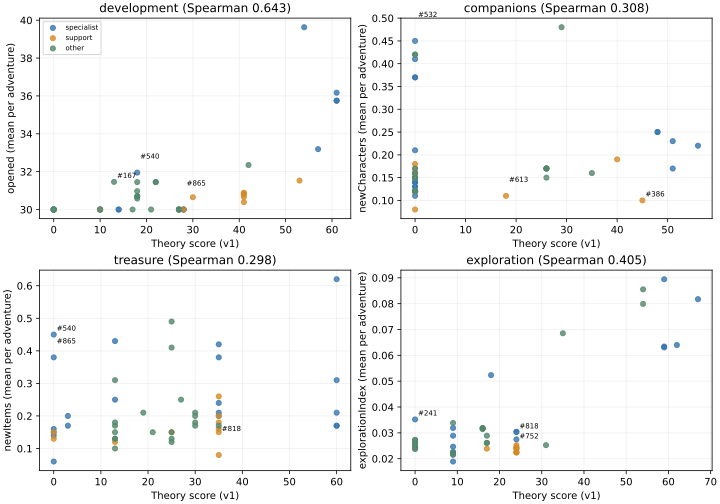

# Phase 4：50キャラクター×100冒険の第1回実測

対象：main ver.74 / `557a7b1a5a69bc6e2132e935794b6d47e544d989`、理論仕様 `1.0.0-draft`。基本5,000冒険、支援補助3,000冒険を完了。採点仕様・本体・マスター・セーブ形式・版番号は変更していない。実測記録と記述分析のみであり、Phase 5の配点調整は未実施。

## 固定条件と50体の選定

10×10、30問、正解率100%、通常出発3回目、累計開拓0。仲間464/927体（50.054%）、お宝240/480種類（50%）を固定シードのFisher–Yatesで抽出。全参加54体を所有させるため28体を入替え、全条件共通の464体を維持した。変更前集合・追加28体・除外28体・最終集合はconfig.json/initial-save.jsonに保存。各冒険で同じ状態へリセットする。

博物館は受取済み0件、6効果とも0段階。所持品の偶然の小分類完成は受取済みと扱わず、自動受取もしない。開始後の加入・品物はその冒険内のみ所持補正へ反映。基本シードは2026102900〜2026102999、支援は2026103900〜2026103999。

選定は理論点だけで実行前に固定した。各専門5体×4、分野最小点優先の複数分野型5、E01〜E08とD06 Lv1/Lv3の支援10、低得点5、中程度5、無作為5。中程度枠では未カバーのB系代表を優先する。選定50体と補助パートナー4体を除く873体をPhase 6候補として分離（過去研究全体の未使用を保証する集合ではない）。

| ID・登録名 | 枠 | スキル | 理論 開拓/仲間/お宝/探索 |
|---|---|---|---|
| #250 ドラゴルム | development-high | A09 Lv3 / C25 Lv3 / E06 Lv3 | 61/0/35/24 |
| #571 フロストガーゴイル | development-high | A09 Lv3 / C13 Lv3 / E06 Lv3 | 61/0/35/24 |
| #586 モスグラン | development-high | A06 Lv3 / C16 Lv3 / E03 Lv3 | 61/0/35/24 |
| #652 モスウッド | development-high | A03 Lv2 / A07 Lv3 / E02 Lv1 | 57/0/0/9 |
| #241 ドラヴァル | development-high | A06 Lv2 / A11 Lv2 / C25 Lv1 | 54/0/13/0 |
| #190 巫女アヤメ | companions-high | D07 Lv3 | 0/56/0/0 |
| #355 セイレーネ | companions-high | D07 Lv2 / D09 Lv1 / E05 Lv1 | 14/51/3/9 |
| #160 忍者ハヤテ | companions-high | D02 Lv3 | 0/51/0/0 |
| #594 ストーンタワー | companions-high | D02 Lv2 / D09 Lv1 / E03 Lv1 | 14/48/3/9 |
| #199 犬着ぐるみポポ | companions-high | D01 Lv3 | 0/48/0/0 |
| #823 ブラッドミミック | treasure-high | C03 Lv3 / C18 Lv1 / E02 Lv1 | 10/0/60/9 |
| #549 スノーオウル | treasure-high | A09 Lv1 / C03 Lv3 / C11 Lv1 | 18/0/60/0 |
| #564 ドラゴンフライ | treasure-high | C03 Lv3 / C25 Lv1 / E05 Lv1 | 10/0/60/9 |
| #30 神官オルフェン | treasure-high | B07 Lv1 / C03 Lv3 / C07 Lv1 | 0/0/60/18 |
| #862 アイアンナイト | treasure-high | C03 Lv3 / C08 Lv1 / E01 Lv1 | 10/0/60/9 |
| #540 ホーリーフェニックス | exploration-high | A07 Lv1 / B01 Lv2 / B02 Lv3 | 18/0/0/67 |
| #865 ポットン | exploration-high | B06 Lv2 / B07 Lv1 / E04 Lv3 | 28/0/0/62 |
| #539 アビスクロウ | exploration-high | B02 Lv3 / C24 Lv3 / E03 Lv3 | 28/0/35/59 |
| #831 フローラミミック | exploration-high | B02 Lv3 / C05 Lv3 / E04 Lv3 | 28/0/35/59 |
| #532 ガルーダ | exploration-high | B01 Lv2 / B07 Lv2 / C26 Lv1 | 0/0/13/59 |
| #572 アビスガーゴイル | balanced | C14 Lv1 / D08 Lv2 / E08 Lv2 | 17/26/19/17 |
| #855 アビスデビル | balanced | C27 Lv2 / D09 Lv2 / E03 Lv2 | 27/26/30/16 |
| #598 モスゴレガス | balanced | C19 Lv2 / D09 Lv2 / E03 Lv2 | 27/26/30/16 |
| #736 フローラピリット | balanced | C26 Lv2 / D09 Lv2 / E01 Lv2 | 27/26/30/16 |
| #809 アビスウェイブ | balanced | C24 Lv2 / D09 Lv2 / E05 Lv2 | 27/26/30/16 |
| #752 ドクスラ | support | A10 Lv1 / C04 Lv2 / E01 Lv3 | 41/0/35/24 |
| #818 赤ずきんピピ | support | C24 Lv3 / D04 Lv1 / E02 Lv3 | 28/0/35/24 |
| #627 アビスクリスタ | support | A05 Lv1 / C18 Lv3 / E03 Lv3 | 41/0/35/24 |
| #794 アクアピリットン | support | A05 Lv1 / C26 Lv3 / E04 Lv3 | 41/0/35/24 |
| #378 トラフグン | support | A06 Lv3 / C26 Lv3 / E05 Lv3 | 53/0/35/24 |
| #608 シルバーゴレム | support | A06 Lv1 / D02 Lv2 / E06 Lv3 | 41/40/0/24 |
| #729 ボーンマンティス | support | A05 Lv1 / C09 Lv3 / E07 Lv3 | 41/0/35/24 |
| #313 ゴブファイター | support | A10 Lv1 / C15 Lv1 / E08 Lv3 | 30/0/13/24 |
| #613 ギアゴレド | support | C13 Lv2 / D06 Lv1 / E08 Lv2 | 10/18/25/17 |
| #386 オークコック | support | D06 Lv3 | 0/45/0/0 |
| #167 槍武者シンゲン | low | A01 Lv1 / C07 Lv1 / D04 Lv2 | 13/0/13/0 |
| #762 クリスタルスラ | low | C17 Lv1 / D04 Lv2 / F01 Lv1 | 0/0/27/0 |
| #775 アクアジェリー | low | A08 Lv1 / C15 Lv1 / D04 Lv3 | 18/0/13/0 |
| #757 フレイムスラ | low | A09 Lv1 / C28 Lv1 / D04 Lv3 | 18/0/13/0 |
| #860 ブラックナイト | low | A06 Lv1 / C08 Lv1 / D04 Lv3 | 18/0/13/0 |
| #329 クロウレンジャー | medium | B03 Lv2 / C09 Lv1 / D01 Lv1 | 0/29/13/35 |
| #35 旅人アルド | medium | B04 Lv2 / B07 Lv2 / C20 Lv2 | 0/0/25/54 |
| #46 魔導士アッシュ | medium | B05 Lv2 / B07 Lv2 / C09 Lv2 | 0/0/25/54 |
| #38 巫女レナ | medium | A01 Lv1 / C21 Lv2 / E08 Lv2 | 22/0/25/17 |
| #538 フェニックス | medium | A01 Lv1 / C05 Lv2 / E08 Lv2 | 22/0/25/17 |
| #646 アビストレント | random | A05 Lv3 / C16 Lv1 / E05 Lv1 | 42/0/13/9 |
| #642 フローラント | random | A05 Lv1 / C16 Lv3 / D04 Lv1 | 18/0/35/0 |
| #66 呪術師ガルシア | random | C21 Lv2 / E01 Lv2 / E08 Lv2 | 27/0/25/31 |
| #473 ブリキ兵 | random | C23 Lv1 / D08 Lv3 / E07 Lv1 | 21/35/21/9 |
| #786 フロストドラグ | random | C18 Lv1 / D04 Lv3 / E06 Lv1 | 10/0/13/9 |

## 成果の定義と集計

開拓の主指標は開拓セル数（拠点除外）。仲間は新規加入種類数、お宝は新規獲得種類数。探索は既存phase2の公開情報に基づく `(0.55×施設発見AUC＋0.45×訪問数)/30`。AUCは各施設の初めて位置が公開された問題数tに対し `(31−t)/31` を加算する。B04の矢印・B07の区画数だけで正確な施設位置が判明したとは数えず、行動への有用性を訪問等に反映する。

character-statistics.csvに50体×33指標の平均・中央値・標本標準偏差（分母99）・最小・最大を保存。character-summary.csvは平均・標準偏差の横持ち版。累計透視数はachievementVisionCount、終了時未開拓透視数はremainingRevealとして区別する。探知数はB02/B03が位置を公開した未開拓施設の一意数。勧誘の初回試行とD07再試行を分け、C03追加品と成功イベント数も別に記録。

| 分野 | 50体平均の平均 | キャラ平均の最小〜最大 | Spearman順位相関 | 共通seedブートストラップ95%区間 | Pearson |
|---|---:|---:|---:|---|---:|
| 開拓 | 30.986 | 30.000〜39.630 | 0.643 | 0.630〜0.652 | 0.688 |
| 仲間 | 0.191 | 0.080〜0.480 | 0.308 | -0.007〜0.370 | 0.074 |
| お宝 | 0.218 | 0.060〜0.620 | 0.298 | 0.052〜0.352 | 0.211 |
| 探索 | 0.034 | 0.019〜0.089 | 0.405 | 0.249〜0.582 | 0.819 |

順位は同点平均順位。区間は100個の共通seed列を再標本化する1,000反復（seed 2026102808）。50体は意図的な層別標本であり、区間はこの50体でのseedばらつきを示し、927体全体の標本抽出誤差・将来条件の不確かさを含まない。相関だけで採点モデルの合否を決めない。

## 各分野の上位・下位と乖離

### 開拓

| 順 | 実測上位（理論点） | 平均 | 実測下位（理論点） | 平均 |
|---:|---|---:|---|---:|
| 1 | #241 ドラヴァル（54） | 39.630 | #30 神官オルフェン（0） | 30.000 |
| 2 | #586 モスグラン（61） | 36.170 | #35 旅人アルド（0） | 30.000 |
| 3 | #250 ドラゴルム（61） | 35.750 | #46 魔導士アッシュ（0） | 30.000 |
| 4 | #571 フロストガーゴイル（61） | 35.750 | #66 呪術師ガルシア（27） | 30.000 |
| 5 | #652 モスウッド（57） | 33.190 | #160 忍者ハヤテ（0） | 30.000 |

理論順位より実測順位が低い例：#539 アビスクロウ（理論28点、平均30.000、順位差+21）、#818 赤ずきんピピ（理論28点、平均30.000、順位差+21）、#831 フローラミミック（理論28点、平均30.000、順位差+21）。
理論順位より実測順位が高い例：#167 槍武者シンゲン（理論13点、平均31.460、順位差-26）、#540 ホーリーフェニックス（理論18点、平均31.950、順位差-21.5）、#642 フローラント（理論18点、平均31.450、順位差-17.5）。

### 仲間

| 順 | 実測上位（理論点） | 平均 | 実測下位（理論点） | 平均 |
|---:|---|---:|---|---:|
| 1 | #329 クロウレンジャー（29） | 0.480 | #794 アクアピリットン（0） | 0.080 |
| 2 | #532 ガルーダ（0） | 0.450 | #386 オークコック（45） | 0.100 |
| 3 | #35 旅人アルド（0） | 0.420 | #613 ギアゴレド（18） | 0.110 |
| 4 | #46 魔導士アッシュ（0） | 0.420 | #862 アイアンナイト（0） | 0.110 |
| 5 | #865 ポットン（0） | 0.410 | #38 巫女レナ（0） | 0.120 |

理論順位より実測順位が低い例：#386 オークコック（理論45点、平均0.100、順位差+43）、#613 ギアゴレド（理論18点、平均0.110、順位差+32.5）、#809 アビスウェイブ（理論26点、平均0.150、順位差+18.5）。
理論順位より実測順位が高い例：#532 ガルーダ（理論0点、平均0.450、順位差-31）、#35 旅人アルド（理論0点、平均0.420、順位差-29.5）、#46 魔導士アッシュ（理論0点、平均0.420、順位差-29.5）。

### お宝

| 順 | 実測上位（理論点） | 平均 | 実測下位（理論点） | 平均 |
|---:|---|---:|---|---:|
| 1 | #30 神官オルフェン（60） | 0.620 | #199 犬着ぐるみポポ（0） | 0.060 |
| 2 | #46 魔導士アッシュ（25） | 0.490 | #818 赤ずきんピピ（35） | 0.080 |
| 3 | #540 ホーリーフェニックス（0） | 0.450 | #786 フロストドラグ（13） | 0.100 |
| 4 | #532 ガルーダ（13） | 0.430 | #313 ゴブファイター（13） | 0.120 |
| 5 | #539 アビスクロウ（35） | 0.420 | #538 フェニックス（25） | 0.120 |

理論順位より実測順位が低い例：#818 赤ずきんピピ（理論35点、平均0.080、順位差+37.5）、#378 トラフグン（理論35点、平均0.150、順位差+25.5）、#564 ドラゴンフライ（理論60点、平均0.170、順位差+25.5）。
理論順位より実測順位が高い例：#540 ホーリーフェニックス（理論0点、平均0.450、順位差-43.5）、#865 ポットン（理論0点、平均0.380、順位差-39）、#532 ガルーダ（理論13点、平均0.430、順位差-31.5）。

### 探索

| 順 | 実測上位（理論点） | 平均 | 実測下位（理論点） | 平均 |
|---:|---|---:|---|---:|
| 1 | #532 ガルーダ（59） | 0.089 | #564 ドラゴンフライ（9） | 0.019 |
| 2 | #35 旅人アルド（54） | 0.086 | #646 アビストレント（9） | 0.021 |
| 3 | #540 ホーリーフェニックス（67） | 0.082 | #862 アイアンナイト（9） | 0.022 |
| 4 | #46 魔導士アッシュ（54） | 0.080 | #752 ドクスラ（24） | 0.022 |
| 5 | #329 クロウレンジャー（35） | 0.069 | #818 赤ずきんピピ（24） | 0.022 |

理論順位より実測順位が低い例：#752 ドクスラ（理論24点、平均0.022、順位差+32）、#818 赤ずきんピピ（理論24点、平均0.022、順位差+31）、#313 ゴブファイター（理論24点、平均0.022、順位差+30）。
理論順位より実測順位が高い例：#241 ドラヴァル（理論0点、平均0.035、順位差-34.5）、#473 ブリキ兵（理論9点、平均0.034、順位差-23）、#167 槍武者シンゲン（理論0点、平均0.027、順位差-22.5）。

## 仲間0点と高得点の比較

| 群 | 人数 | 冒険数 | 新規加入平均 | 勧誘成功平均 | 仲間イベント平均 |
|---|---:|---:|---:|---:|---:|
| theoryZero | 35 | 3500 | 0.188 | 0.354 | 0.621 |
| theory40Plus | 7 | 700 | 0.201 | 0.389 | 0.524 |

0点は仲間イベントが起きない意味ではない。基本施設イベントと60%の成功率がある。B系・開拓系が施設到達を増やせば、仲間の理論点0でも新規加入が増える。両群の比較は保有スキルも異なる記述比較。

## お宝分類特化とB系情報

分類特化は総獲得数の増加と同義ではない。対象分類取得比率・新規取得をcollector-effects.csvへ保存。分類の初期所持偏りと他スキルが交絡するので、個別スキルの因果効果と断定しない。F01の選択は未所持優先のみで、目標分類を恣意的に優遇しない。

| キャラ | 分類スキル | 対象分類/総獲得 | 比率 | 新規種類平均 |
|---|---|---:|---:|---:|
| #250 ドラゴルム | C25 Lv3 | 25/35 | 71.4% | 0.210 |
| #571 フロストガーゴイル | C13 Lv3 | 18/35 | 51.4% | 0.200 |
| #586 モスグラン | C16 Lv3 | 23/43 | 53.5% | 0.240 |
| #241 ドラヴァル | C25 Lv1 | 12/39 | 30.8% | 0.250 |
| #823 ブラッドミミック | C18 Lv1 | 14/37 | 37.8% | 0.170 |
| #549 スノーオウル | C11 Lv1 | 9/50 | 18.0% | 0.310 |
| #564 ドラゴンフライ | C25 Lv1 | 7/37 | 18.9% | 0.170 |
| #30 神官オルフェン | C07 Lv1 | 20/121 | 16.5% | 0.620 |
| #862 アイアンナイト | C08 Lv1 | 8/35 | 22.9% | 0.210 |
| #539 アビスクロウ | C24 Lv3 | 52/85 | 61.2% | 0.420 |
| #831 フローラミミック | C05 Lv3 | 46/85 | 54.1% | 0.380 |
| #532 ガルーダ | C26 Lv1 | 15/81 | 18.5% | 0.430 |
| #572 アビスガーゴイル | C14 Lv1 | 8/36 | 22.2% | 0.210 |
| #855 アビスデビル | C27 Lv2 | 9/34 | 26.5% | 0.210 |
| #598 モスゴレガス | C19 Lv2 | 11/34 | 32.4% | 0.170 |
| #736 フローラピリット | C26 Lv2 | 14/40 | 35.0% | 0.200 |
| #809 アビスウェイブ | C24 Lv2 | 9/36 | 25.0% | 0.180 |
| #818 赤ずきんピピ | C24 Lv3 | 12/19 | 63.2% | 0.080 |
| #627 アビスクリスタ | C18 Lv3 | 16/27 | 59.3% | 0.180 |
| #794 アクアピリットン | C26 Lv3 | 24/34 | 70.6% | 0.200 |
| #378 トラフグン | C26 Lv3 | 18/28 | 64.3% | 0.150 |
| #729 ボーンマンティス | C09 Lv3 | 18/30 | 60.0% | 0.160 |
| #313 ゴブファイター | C15 Lv1 | 4/24 | 16.7% | 0.120 |
| #613 ギアゴレド | C13 Lv2 | 9/29 | 31.0% | 0.150 |
| #167 槍武者シンゲン | C07 Lv1 | 12/47 | 25.5% | 0.310 |
| #762 クリスタルスラ | C17 Lv1 | 4/35 | 11.4% | 0.250 |
| #775 アクアジェリー | C15 Lv1 | 9/35 | 25.7% | 0.130 |
| #757 フレイムスラ | C28 Lv1 | 5/29 | 17.2% | 0.180 |
| #860 ブラックナイト | C08 Lv1 | 8/36 | 22.2% | 0.150 |
| #329 クロウレンジャー | C09 Lv1 | 4/31 | 12.9% | 0.170 |
| #35 旅人アルド | C20 Lv2 | 31/84 | 36.9% | 0.410 |
| #46 魔導士アッシュ | C09 Lv2 | 34/104 | 32.7% | 0.490 |
| #38 巫女レナ | C21 Lv2 | 8/26 | 30.8% | 0.150 |
| #538 フェニックス | C05 Lv2 | 9/26 | 34.6% | 0.120 |
| #646 アビストレント | C16 Lv1 | 3/29 | 10.3% | 0.130 |
| #642 フローラント | C16 Lv3 | 18/32 | 56.2% | 0.170 |
| #66 呪術師ガルシア | C21 Lv2 | 14/33 | 42.4% | 0.130 |
| #473 ブリキ兵 | C23 Lv1 | 6/36 | 16.7% | 0.150 |
| #786 フロストドラグ | C18 Lv1 | 8/21 | 38.1% | 0.100 |

| B系 | 保有人数 | 発見平均 | 訪問平均 | 累計透視平均 | 位置探知平均 |
|---|---:|---:|---:|---:|---:|
| B01 | 2 | 2.850 | 2.820 | 82.610 | 0.780 |
| B02 | 3 | 2.240 | 2.220 | 26.990 | 1.560 |
| B03 | 1 | 2.260 | 2.260 | 0.000 | 1.790 |
| B04 | 1 | 3.000 | 3.000 | 0.000 | 0.000 |
| B05 | 1 | 3.000 | 3.000 | 60.000 | 0.000 |
| B06 | 1 | 2.450 | 2.450 | 20.000 | 0.000 |
| B07 | 5 | 2.728 | 2.728 | 32.850 | 0.000 |

全B系で公開信号の除去によりAIの選択が変わる予備検証を実施済み。B01/B05/B06の透視、B02/B03の探知位置、B04の矢印、B07の区画密度を利用する。表の保有者平均は他スキルも含むため、B系単独の因果効果にはしない。

## 支援補助：固定10ケース×3条件×100seed＝3,000冒険

各ケースでpartner-only、with-support、ablated-supportを比較。ablatedは支援者のID・groupId・他スキル・人数を保ち、対象EまたはD06だけをメモリ内で除外した反実仮想。JSONマスター自体は変更していない。with−ablatedが対象スキルの効果、ablated−partner-onlyが残りスキルと所属グループ追加、with−partner-onlyが追加全体であり、混同しない。D06は同seedで実現地図も一致。E系は地形を変える介入であり、同一実現地図への固定はしていない。

差の区間は共通seedの対応差100本に基づくt区間。多数比較の補正なし。E08では整形が乱数を消費し、後続の施設位置・種類もずれるため、地形だけの機序へ差を全て帰属できない。E系各1体とD06各Lv1/3各1体という限定されたパートナー条件である。

| 支援キャラ | 対象 | 固定パートナー | 対象スキルの開拓差 | 新規仲間差 | 新規お宝差 | 探索指数差 |
|---|---|---|---:|---:|---:|---:|
| #752 ドクスラ | E01 | #463 キャノンナイト | +3.510 | +0.090 | +0.110 | +0.007 |
| #818 赤ずきんピピ | E02 | #646 アビストレント | +4.100 | +0.050 | +0.040 | +0.005 |
| #627 アビスクリスタ | E03 | #378 トラフグン | +3.180 | +0.020 | +0.050 | +0.008 |
| #794 アクアピリットン | E04 | #652 モスウッド | +2.820 | +0.020 | -0.080 | +0.002 |
| #378 トラフグン | E05 | #609 ジェイドゴレム | +1.490 | -0.050 | -0.070 | -0.002 |
| #608 シルバーゴレム | E06 | #778 ミストジェリー | +3.640 | +0.030 | +0.000 | +0.008 |
| #729 ボーンマンティス | E07 | #724 アビススコーピオン | +3.280 | +0.030 | -0.090 | +0.001 |
| #313 ゴブファイター | E08 | #646 アビストレント | -0.040 | +0.070 | -0.010 | +0.001 |
| #613 ギアゴレド | D06 | #160 忍者ハヤテ | +0.000 | +0.020 | +0.000 | +0.000 |
| #386 オークコック | D06 | #160 忍者ハヤテ | +0.000 | +0.050 | +0.000 | +0.000 |

E系は地形特攻パートナーを優先し、E08はA05、D06はD02パートナーを選定。全構成とスキルはconfig.jsonに実行前保存。D06の価値は総加入数だけでなく対象大分類への偏りにもあるので、groupJoinsも併記する。

| D06支援 | 対象分類加入差 | 対応差95%区間 |
|---|---:|---|
| #613 ギアゴレド | +0.040 | +0.001〜+0.079 |
| #386 オークコック | +0.130 | +0.047〜+0.213 |

E/D06の支援点を一人旅の成果だけで減点しない。正負の差・区間の広さ・他の支援者や進行条件への一般化をPhase 5で検討する。

## 終盤・飽和・条件依存

5,000冒険の最大開拓は42マス、全域99マス到達は0件。A12の残り20%以下に入った冒険は0件、対象ターンは0回。追加開拓の開けなかった効果は9件、該当冒険は9件。
選定50体でカバーしたスキルは54/67種。未保有スキルはA02、A04、A12、C01、C02、C06、C10、C12、C22、D03、D05、F02、F03。A12保有者は0体で、終盤条件に達した冒険も0件のため、A12の実測評価は今回成立していない。
30問では終盤到達を十分観測できない場合、A12や終盤の残りマス飽和の妥当性を確認済みとしない。終盤前でも隣接枯渇で追加処理が止まる例は別に検出する。長期冒険の追加実験・採点改訂は今回開始しない。

## 実装との差異と解釈

ゲームの生成・開拓・抽選・Lv合算・施設制約・所持補正・博物館処理は実コードをVMで読み込み、再実装しない。差異の全一覧はENGINE-DIFFERENCES.md。人間の操作を代表しない公開情報AI、施設の即時訪問、未所持優先選択、誤答なし、固定所有・受取0段階、UI/保存/称号演出省略という条件が結果へ影響する。E介入時の乱数消費ずれと、分類の初期所持偏りも残る。

## 検証・時間・Phase 5への引継ぎ

予備検証17項目に合格してから実行。基本計算のグループ実行時間合計は86.724秒、支援は51.893秒。CPU共有で一部並行実行しており合計は壁時計時間ではない。CSV保存時間を含み、分析・検証・転送時間を含まない。停止再開の履歴と各100/300件の進捗はprogress.jsonl/runs.jsonl。最終検証はverification.json/validation.log。

- 理論上の専門性と、施設到達を介した他分野成果の関係を確認する。特に仲間0点でも基礎加入や探索由来の加入がある。
- 分類収集家の点を総新規種類数だけで検証せず、対象分類の価値を別軸で扱う。
- B系は公開情報を利用するAIで測定できたが、方針選択に依存する。別の人間方針や移動コストへ一般化しない。
- E01〜E07の特攻支援、E08の配置と施設乱数消費、D06の分類偏りを分けて解釈する。支援値の改訂は未承認。
- 30問で未到達の終盤・A12、博物館ボーナスの非0条件、異なる初期所持集合、未使用873体の検証は未実施。
- 今回の乖離はPhase 5の検討資料であり、v1を変更していない。Phase 6候補へ実測を広げていない。

## 理論点と実測の散布図

